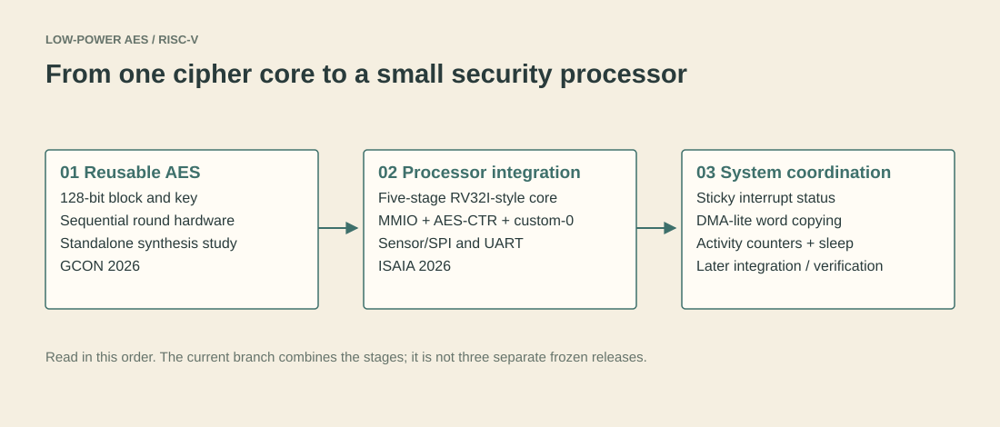

# Low-power AES-128 on a RISC-V processor

This project started with a compact AES-128 encryption core, then grew into a small RISC-V system that can collect a sensor value, encrypt it, and send a result over UART. The later work adds AES-CTR, custom instructions, DMA-lite, interrupt status and activity counters.

The interesting part is the progression: first understand the cipher hardware, then how a 32-bit processor controls it, and finally how the surrounding system coordinates work.



## The two papers

| Paper | What to look at here |
| --- | --- |
| [IEEE GCON 2026: Iterative and Hardware-Reusable AES-128 Architecture for FPGA and IoT Applications](docs/papers/gcon-2026.md) | Reusable AES datapath, round controller, standalone synthesis evidence |
| [IEEE ISAIA 2026: A Lightweight RISC-V Security Processor with AES-CTR Acceleration and Custom ISA Support for IoT Edge Nodes](docs/papers/isaia-2026.md) | Processor integration, AES-CTR, custom-0 instructions and peripheral interfaces |

Each paper page links to the relevant code, explanations and results. They are also convenient links to place under the corresponding LinkedIn publication. This branch contains the integrated project and later verification material; it is not claimed to be an exact frozen artifact for both papers.

## Where to start

If you are new to RTL, read [Start here](docs/start-here.md). It explains the few concepts needed before opening the code.

1. [The reusable AES core](docs/01-aes-core.md): bytes, rounds, handshakes and the area/latency tradeoff.
2. [Connecting AES to RISC-V](docs/02-riscv-integration.md): the pipeline, MMIO, word order and custom instructions.
3. [Interrupts, DMA and power activity](docs/03-interrupts-and-power.md): events, sticky flags, copying and sleep control.
4. [How the design is checked](docs/04-verification.md): directed tests, the independent C model and UVM scope.
5. [Reading the results](docs/05-results.md): what the reports establish and what they do not.

Prefer a shorter route? Open the [documentation map](docs/README.md), [register reference](docs/register-map.md), or [waveform gallery](results/README.md).

## Run a first test

The supplied simulation flow uses Questa on Windows. Python is needed only for the repository checks, not for RTL simulation. Run these from the repository root:

```powershell
# Check links, source lists and project paths; no EDA licence required.
python scripts/check_repo.py

# Start with AES alone. This checks two known-answer vectors and its handshake.
powershell -NoProfile -ExecutionPolicy RemoteSigned -File scripts/run_simulation.ps1 -Mode AesCore

# Then exercise the integrated processor and peripherals.
powershell -NoProfile -ExecutionPolicy RemoteSigned -File scripts/run_simulation.ps1 -Mode All
```

`RemoteSigned` applies to that PowerShell process; the command does not change the machine's execution-policy setting. Questa tools must be on `PATH`, or pass `-QuestaBin "C:/path/to/questa/win64"`. Fresh logs and waveforms go into ignored `build/` folders, leaving the original research evidence untouched.

See [Running the project](docs/running.md) for smaller test modes, UVM, coverage, waveform viewing, FPGA and ASIC requirements.

## Repository layout

```text
rtl/
  aes/             reusable core, compatibility wrapper and MMIO peripheral
  cpu/             pipeline stages, hazard logic and data memory
  peripherals/     SPI wrapper, UART, interrupt controller, DMA and counters
  top/             integrated system
tb/                directed tests, UVM, C reference and source lists
scripts/           simulation entry point and repository checks
fpga/              Quartus project and generated Intel/Altera SPI IP
asic/              standalone AES synthesis flow and original reports
results/           original simulation and FPGA evidence
docs/              learning chapters, paper pages, figures and thesis material
```

Lowercase descriptive filenames are used for new files. Historical RTL module names remain unchanged so the integration and existing waveform hierarchy stay compatible.

## A few important boundaries

This is a research/teaching prototype, not a certified processor or production security device. It uses an RV32I-style pipeline, but does not implement a complete privileged CSR/trap/interrupt-handler path. AES-CTR provides confidentiality, not authentication. Activity counters do not measure electrical power, and ASIC/FPGA power estimates should not be mixed.

The UVM environment checks the AES/UART subsystem, not the whole CPU. The separate CPU-driven scenario checks the integrated system. [Verification](docs/04-verification.md) and [limitations](docs/limitations.md) explain these distinctions.

Work by Varada Inamdar, M.Tech VLSI Design, COEP Technological University, guided by Dr. Ashwini Kulkarni. Paper-specific authorship is listed on the two paper pages.

[Original evidence](results/README.md) · [Thesis and slides](docs/research/README.md) · [Cleanup notes](docs/maintenance.md) · [Third-party notices](NOTICE.md)
