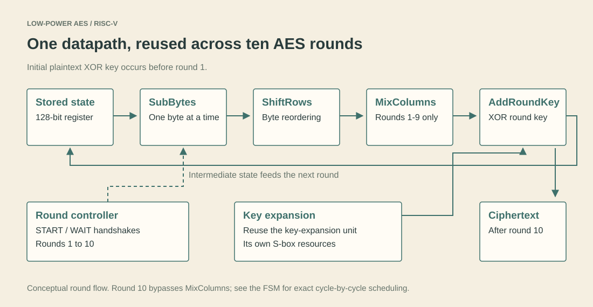
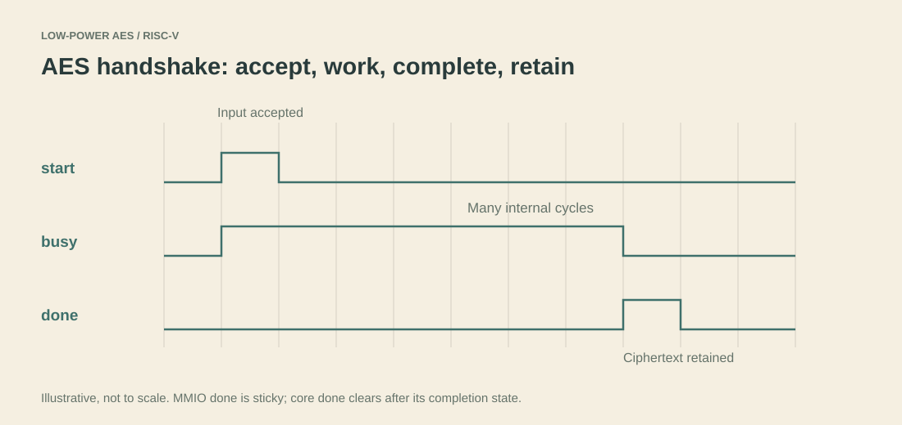

# 1. The reusable AES core

[Home](../README.md) · Previous: [Start here](start-here.md) · Next: [RISC-V integration](02-riscv-integration.md)

The first part of the project asks a hardware question: can AES-128 be implemented with less duplicated logic by doing more work over time? The [GCON paper](papers/gcon-2026.md) belongs to this part of the work.

## What AES-128 operates on

AES uses a 128-bit block: 16 bytes. AES-128 also uses a 128-bit key. Encryption begins with AddRoundKey, followed by ten rounds. Rounds 1-9 contain SubBytes, ShiftRows, MixColumns and AddRoundKey. The last round omits MixColumns. Key expansion derives the round keys.

These transformations are specified by [NIST FIPS 197](https://csrc.nist.gov/pubs/fips/197/final). The contribution here is the hardware organization, not a new cipher.



## What is reused

The [core](../rtl/aes/aes128_core.sv) instantiates one sequential SubBytes unit, one sequential MixColumns unit, and one key-expansion unit. The same instances run again for each round.

| Source | What to notice |
| --- | --- |
| [aes_sbox_rom.sv](../rtl/aes/aes_sbox_rom.sv) | Lookup from one byte to its substituted byte |
| [aes_sbox_seq.sv](../rtl/aes/aes_sbox_seq.sv) | `idx` steps across the 16 state bytes |
| [aes_mix_columns_seq.sv](../rtl/aes/aes_mix_columns_seq.sv) | One column is processed at a time |
| [aes_key_expand_seq.sv](../rtl/aes/aes_key_expand_seq.sv) | Generates the current round's key |
| [aes128_core.sv](../rtl/aes/aes128_core.sv) | Coordinates the units with start/done handshakes |

The SubBytes datapath uses one S-box ROM instance. Key expansion has its own S-box instances; it would be inaccurate to say the entire core contains only one S-box.

## Follow one block through the controller

In `S_IDLE`, a start request captures the initial `plaintext ^ key`, the original key, and round number 1. The controller pulses `sbox_start`, waits for `sbox_done`, then applies ShiftRows to the completed substituted state.

For rounds 1-9 it starts MixColumns and waits for its result. It then starts key expansion, waits for `key_done`, and XORs the transformed state with `new_key`. It increments the round and reuses the same units. Round 10 skips MixColumns. Its final XOR is stored as `ciphertext`, and `S_DONE` asserts completion before returning to IDLE.

The word *sequential* matters. A helper's start pulse, its internal work and the parent's observation of done occupy different clock edges. Do not estimate total latency by counting only the ten algorithmic rounds.

## Interface contract

For direct use of `AES128_updated_new`, hold the input block and key valid when start is accepted in IDLE. Pulse start for one cycle. Wait for done; do not assume a fixed number of cycles in software. `busy` indicates processing, and ciphertext remains stored after completion.



The [compatibility wrapper](../rtl/aes/aes128_lowpower.sv) adapts this core to the old SoC interface. It accepts start only when `clk_en` is high and the core is not busy. Its `clk_en` gates **request acceptance**, not the physical clock or every internal update. Once accepted, encryption runs to completion. There is no generated clock in this wrapper.

## A concrete test

```text
key        = 000102030405060708090a0b0c0d0e0f
plaintext  = 00112233445566778899aabbccddeeff
ciphertext = 69c4e0d86a7b0430d8cdb78070b4c55a
```

The [standalone testbench](../tb/directed/aes128_core_tb.sv) checks this vector and a zero-key/zero-plaintext vector. It also injects a second start while busy, checks that done clears, and checks result retention. The test prints its own wait-cycle count; the count uses that testbench's sampling convention and is not a universal MMIO/software latency.

## Why this is called low-power work

Hardware reuse reduces duplicated combinational logic and the amount of work performed simultaneously. That can reduce area and switching activity, but it adds cycles per block. Power, energy per block, latency and throughput are different quantities.

For example, lower average power does not automatically mean lower energy for a long transaction: energy is the integral of power over time. Compare designs at the same technology, voltage, workload and timing assumptions. The [results chapter](05-results.md) separates standalone ASIC estimates from integrated FPGA reports.

The monolithic [ASIC synthesis input](../asic/cadence_genus/rtl/aes128_standalone.sv) is retained for traceability to the original reports. The integrated simulations use the split files in `rtl/aes/`; they do not compile both definitions together.

Try explaining, before moving on: why is there no MixColumns call in round 10, and why does a start pulse not produce ciphertext on the next edge?
