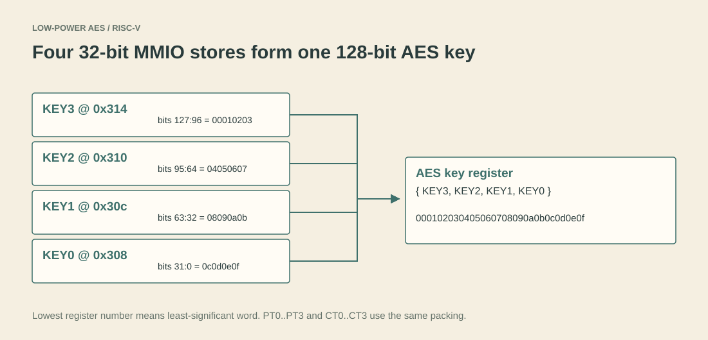

# 2. Connecting AES to RISC-V

[Home](../README.md) · Previous: [AES core](01-aes-core.md) · Next: [Interrupts and power](03-interrupts-and-power.md)

The second part puts the reusable cipher behind a processor interface. This is the focus of the [ISAIA paper](papers/isaia-2026.md): the CPU remains a small five-stage RV32I-style pipeline, while AES-CTR and peripherals sit behind its memory stage.


## The five pipeline stages

| Stage | Job | Starting point in the code |
| --- | --- | --- |
| IF | Fetch an instruction at the program counter | [pc_reg.sv](../rtl/cpu/pc_reg.sv), [if_stage.sv](../rtl/cpu/if_stage.sv) |
| ID | Decode it and read source registers | [id_stage.sv](../rtl/cpu/id_stage.sv), [control_unit.sv](../rtl/cpu/control_unit.sv) |
| EX | ALU work, address calculation and branch decision | [ex_stage.sv](../rtl/cpu/ex_stage.sv) |
| MEM | RAM access or peripheral access | [mem_stage.sv](../rtl/cpu/mem_stage.sv) |
| WB | Select/write the result to a destination register | [wb_stage.sv](../rtl/cpu/wb_stage.sv), [reg_file.sv](../rtl/cpu/reg_file.sv) |

The [top module](../rtl/top/riscv_aes_advancements.sv) connects these stages and their pipeline registers. Forwarding handles some dependencies without waiting for writeback; the [hazard unit](../rtl/cpu/hazard_unit.sv) requests a load-use stall. A taken branch redirects the PC and flushes wrong-path instructions. Read the actual implemented decoding before assuming every instruction described by the RISC-V standard is supported.

## Memory-mapped I/O (MMIO)

An MMIO access looks like an ordinary load or store instruction, but its address selects a peripheral register rather than RAM. The decoder in `mem_stage.sv` selects AES at `0x300`, sensor/SPI at `0x400`, UART at `0x500`, interrupt control at `0x600`, DMA at `0x700`, and power/activity at `0x800`.

These are simple local address windows, not an AXI bus. The [register map](register-map.md) gives the offsets. Outside MMIO, [data_mem.sv](../rtl/cpu/data_mem.sv) holds 256 32-bit words. It indexes byte addresses using bits `[9:2]`; higher bits alias. The AES MMIO window overlaps part of that nominal address range and is intercepted by the decoder. This is a teaching memory map, not a protected flat memory system.

Load/store variant tags travel in internal address bits `[31:29]`, then `mem_stage` removes them. They are an implementation convention between EX and MEM, not an external memory protocol.

## A 32-bit CPU can control 128-bit AES

Four stores assemble each 128-bit value. The lowest-numbered register holds the **least-significant** word. For the NIST key `000102030405060708090a0b0c0d0e0f`, write:

| Register | Absolute address | 32-bit value |
| --- | --- | --- |
| KEY0 | `0x308` | `0x0c0d0e0f` |
| KEY1 | `0x30c` | `0x08090a0b` |
| KEY2 | `0x310` | `0x04050607` |
| KEY3 | `0x314` | `0x00010203` |



Do not confuse this word packing with the AES state matrix or a serial byte order. They are separate conventions. A reversed word order is a common reason for an apparently broken cipher integration.

## ECB-compatible block test and CTR mode

With CTRL bit 2 clear, the peripheral encrypts the plaintext block directly. This is useful for a known-answer check. With bit 2 set, it encrypts `{nonce[63:0], counter[63:0]}` to create a keystream, then XORs that keystream with the plaintext. The counter increments after completion.

CTR uses the same AES encryption primitive for encryption and decryption:

```text
keystream = AES(key, nonce || counter)
ciphertext = plaintext XOR keystream
plaintext  = ciphertext XOR keystream
```

For a new operation, finish programming the data, key, nonce and counter **before** setting start. Keep them stable while busy. The peripheral does not provide a separate transaction snapshot for all input registers and does not block every configuration write while busy. The [AES MMIO source](../rtl/aes/aes_mmio.sv) is the interface authority.

Never reuse a nonce/counter block with the same key for different plaintext. CTR does not detect modification or replay. See [security limitations](limitations.md) and [NIST SP 800-38A](https://csrc.nist.gov/pubs/sp/800/38/a/final).

## Custom instructions: a second control route

The design uses the RISC-V `custom-0` opcode `0b0001011`. The instruction's `funct3` field selects a small project-specific command. This is not the standardized RISC-V scalar cryptography extension.

| Command value | Operation |
| --- | --- |
| 0 | XOR of the two source operands |
| 1 | Read AES status |
| 2 | Start CTR encryption of `{64'b0, rs2, rs1}` |
| 3 | Read the lowest ciphertext word |
| 4 | Clear AES done |

The custom start still uses the previously programmed key, nonce and counter. It does not accept a full key or 128-bit payload in one instruction. It also does not wait for encryption to finish: software must check completion separately.

Follow `custom_instr_o` from [control_unit.sv](../rtl/cpu/control_unit.sv) through EX/MEM and into [aes_mmio.sv](../rtl/aes/aes_mmio.sv). The [directed testbench](../tb/directed/riscv_core_tb.sv) constructs instruction words explicitly; no custom compiler toolchain is included.

The instruction ROM used in simulation is programmable by the testbench. The synthesis branch uses a small fixed example ROM. A successful simulated application therefore does not mean that application has automatically been loaded into the fitted FPGA design.
