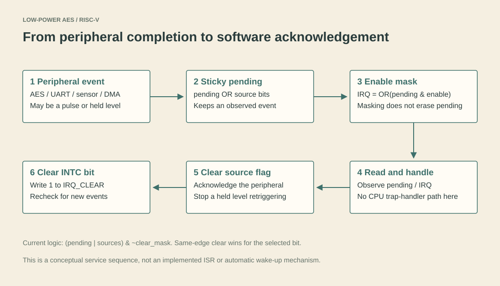

# 3. Interrupts, DMA and power activity

[Home](../README.md) · Previous: [RISC-V integration](02-riscv-integration.md) · Next: [Verification](04-verification.md)

Once AES works behind MMIO, the next question is how the surrounding system notices completion and avoids unnecessary work. This chapter covers the later system features. It does not describe a complete operating system or production power manager.

## Why a completion event needs storage

A peripheral can complete in one clock cycle while software reads its status much later. The [interrupt controller](../rtl/peripherals/simple_intc.sv) turns observed events into sticky pending bits. A pending bit stays set until it is cleared; it is not a count of how many events occurred.

| Bit | Source |
| --- | --- |
| 0 | AES done |
| 1 | UART transmit done |
| 2 | Sensor data ready |
| 3 | DMA done |

The combined interrupt line is `|(pending_reg & enable_reg)`. Masking a source prevents it from raising this line, but does not prevent its event from becoming pending. The controller is enabled independently of the peripheral sleep enables, so its status logic remains available.

## Clearing the source and the controller are different

AES, UART and DMA completion can remain asserted at the peripheral until acknowledged. Clearing only the interrupt-controller bit can therefore cause it to become pending again on a later cycle.

A normal software acknowledgement sequence is:

1. Read pending status and identify the source.
2. Handle the result and clear the peripheral's completion/status flag.
3. Write 1 to the corresponding interrupt CLEAR bit.
4. Re-read pending if another event might have arrived.

This is a conceptual MMIO service sequence, not a supplied CPU trap-handler implementation. The current CPU exposes `irq_debug`; it does not vector into an ISR using `mtvec`, `mepc`, `mstatus` and `mret`.

The controller implements `(pending | sources) & ~clear_mask`. If a clear and a source occur on the same edge, the selected pending bit is cleared on that edge. A source that stays high can be recorded on the next edge. Do not describe this as unconditional event-wins priority.

## DMA-lite: move words without repeated CPU copying

The [DMA engine](../rtl/peripherals/dma_lite.sv) has source, destination, length, control and status registers. Length is a count of **32-bit words**, not bytes. While enabled and busy it forwards one RAM word to the DMA write port each cycle, incrementing addresses by four bytes.

It is not an AXI/PCIe bus master, cache-coherent DMA engine or descriptor queue. It uses a direct second port on the [small RAM](../rtl/cpu/data_mem.sv). If CPU and DMA write the same RAM word in the same cycle, the later DMA assignment wins in this implementation. Software should avoid that collision and avoid MMIO addresses as DMA RAM destinations; DMA bypasses the CPU's MMIO decode.

The [full-system scenario](../tb/scenarios/secure_health_monitoring_scenario_testcase.md) stores a sensor sample in RAM, copies it, then programs AES. DMA here does not autonomously feed an arbitrary stream directly into AES.

## Activity counters are observations, not a power meter

The [power/activity peripheral](../rtl/peripherals/power_mgmt_mmio.sv) counts CPU activity, AES activity, UART activity, DMA activity, sensor activity and sleep cycles. CTRL bit 0 requests sleep; bit 1 clears the counters. These are cycle counts. Converting them into watts or energy would require a calibrated model and workload assumptions.

Sleep disables selected peripheral updates through `clk_en_i`. The CPU program counter/pipeline is not globally clock-gated by `sleep_o`, and the AES compatibility wrapper does not stop an accepted encryption in mid-round. There is no power-domain switch, retention flow, physical clock-gating cell or complete interrupt-driven wake-up controller here.

In the demo, sleep is requested after the useful transaction completes. Do not put an active AES/UART/DMA transaction into sleep and assume completion or automatic wake-up is guaranteed. Some configuration and completion capture are disabled during sleep.

## Follow an actual transaction

In [run_full_soc_pipeline_integration_test](../tb/directed/riscv_core_tb.sv), follow these observations: CPU completion marker, sensor read, RAM/DMA copy, AES result, UART completion, pending interrupt bits, then activity counters and sleep. The [original scenario log](../results/full_soc_scenario/07_full_soc_scenario.log) reports 15 passing checks.

At the end, try explaining the difference between AES `done`, an INTC pending bit, the enabled IRQ line and a CPU interrupt handler. They are four different things.
