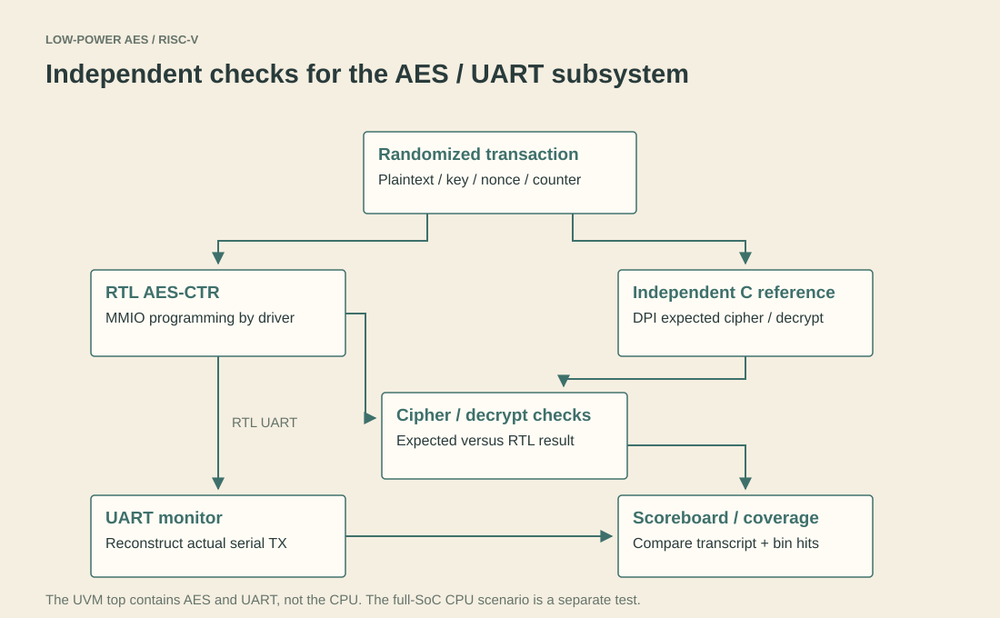

# 4. How the design is checked

[Home](../README.md) · Previous: [Interrupts and power](03-interrupts-and-power.md) · Next: [Results](05-results.md)

Verification is useful only when its scope is clear. The project has a small standalone AES test, a processor/peripheral directed testbench, and a randomized UVM environment for the AES/UART subsystem.

## Start with a known-answer test

[aes128_core_tb.sv](../tb/directed/aes128_core_tb.sv) drives the reusable AES core directly. Its two vectors have fixed expected ciphertext. It also checks busy-start rejection, completion and result retention. This is a quick first boundary to test before looking at CPU instructions or MMIO.

`AesKat` runs the integrated testbench's AES test through the MMIO register interface. It checks done/busy and all four ciphertext words. Passing the core test but failing the MMIO test points toward packing or peripheral control rather than immediately implicating the AES transformations.

## Directed processor and peripheral checks

[riscv_core_tb.sv](../tb/directed/riscv_core_tb.sv) supplies instruction encoders, register/RAM observations, direct peripheral transactions and a CPU-driven application. The mode names select smaller test groups. Some tests bypass the CPU and drive the MEM/peripheral interface; the FullSocScenario test runs its application through IF/ID/EX/MEM/WB.

| Mode | Scope |
| --- | --- |
| `DirectedCpu` | Implemented arithmetic, loads/stores and control-flow examples |
| `DirectedPeripheral` | AES-CTR, sensor/SPI, UART, INTC, DMA, activity and custom commands |
| `RandomSmoke` | A small deterministic randomized smoke test |
| `FullSocScenario` | CPU-driven sensor/RAM/DMA/AES/UART/status/sleep example |
| `All` | The complete directed regression, including additional integration/activity checks |

Do not add the small-mode pass totals and expect them to equal `All`; `All` also includes checks not present in those isolated modes. Historical evidence is linked in the [results gallery](../results/README.md). Fresh validation is recorded separately in [validation.md](../results/validation.md).

## What UVM actually instantiates

[uvm_e2e_tb_top.sv](../tb/uvm/uvm_e2e_tb_top.sv) instantiates **AES MMIO and UART MMIO**, not the whole RISC-V CPU, sensor, DMA or interrupt controller. The driver programs these interfaces directly. This is an end-to-end security-data-path test, not whole-SoC UVM verification.

The [transaction package](../tb/uvm/uvm_e2e_pkg.sv) randomizes plaintext, key, nonce and counter. It sends the same inputs to the RTL and to the [independent C reference model](../tb/reference_model/aes_ctr_ref.c) through DPI. The expected result is not computed by reusing the AES RTL.

The scoreboard checks the RTL ciphertext, reference decryption and UART transcript. The UART monitor reconstructs bytes from the serial TX signal; it does not merely read the driver's expected string.

The textual UART transcript includes **test keys** to make debugging explicit. This is simulation-only diagnostic behavior and must not be used to transmit real secret keys in a deployed system.

## Coverage: useful, but narrowly defined

Portable coverage uses 114 explicitly defined bins for selected plaintext/key/nonce/counter categories, crosses and result flags. A saved 100-transaction run with seed 611 covers all 114. This means 100% of **that model's bins**, not 100% of AES inputs, RTL code, CPU instructions, security threats or possible timing races.

The optional `-NativeCovergroups` mode requires simulator support. It is separate from the portable bin counters; do not label the portable summary as a UCDB/code-coverage sign-off report.

## What is still worth testing

Useful next tests include writes during AES busy, simultaneous peripheral acknowledgements and new events, sleep during an in-flight transfer, counter overflow, DMA/CPU collision, invalid addresses and reset during a transaction. Formal properties could check handshake and status invariants. A wider ISA test suite would be needed before making a RISC-V compliance claim.

For a failed test, inspect the first mismatch and its inputs before looking at the final summary. A simulator that exits successfully can still contain functional failures; the [runner](../scripts/run_simulation.ps1) checks the transcript as well as the process exit status.
