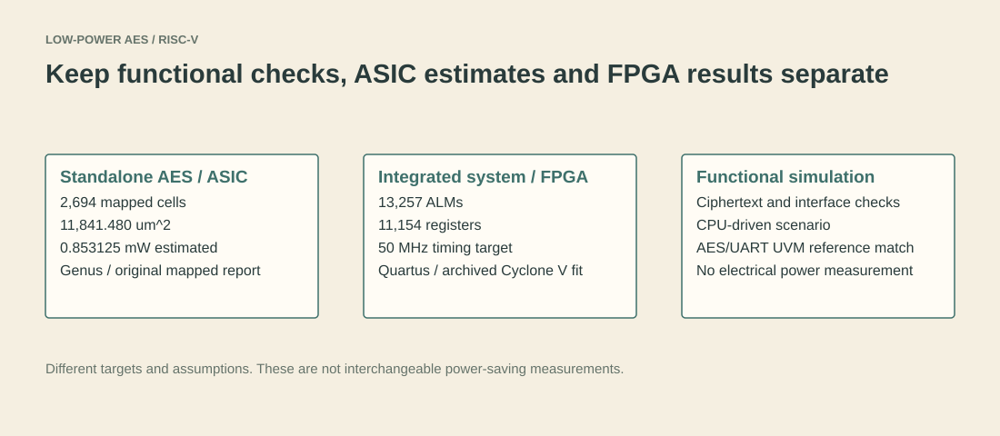

# 5. Reading the results

[Home](../README.md) · Previous: [Verification](04-verification.md) · [Evidence gallery](../results/README.md)

This repository contains results from different experiments. Keep the experiment, technology and date attached to the number. Later verification results are not necessarily the exact results printed in an earlier paper revision.

## Standalone AES: original Genus reports

The checked-in reports describe `AES128_updated_new`, not the full RISC-V system. The area/timing headers identify Genus 23.14 and a typical 1.0 V, 25 C corner; the original flow identifies a 55 nm low-power RVT library.

| Quantity | Direct evidence |
| --- | --- |
| Mapped cell count: 2,694 | [report_area.rpt](../asic/cadence_genus/reports/report_area.rpt) |
| Mapped cell area: 11,841.480 square micrometres | [report_area.rpt](../asic/cadence_genus/reports/report_area.rpt) |
| Estimated total power: 0.853125 mW | [report_power.rpt](../asic/cadence_genus/reports/report_power.rpt), subtotal `8.53125e-04 W` |
| Reported setup slack: 6,806 ps, 10,000 ps clock | [report_timing.rpt](../asic/cadence_genus/reports/report_timing.rpt) |

These are mapped/pre-layout estimates, not measured silicon power or routed sign-off. The licensed technology library is not included. Re-running the flow with a different library will not reproduce the original numbers.

The previous documentation quoted percentage savings against a larger baseline. The baseline's matching raw reports are not present in this snapshot, so those percentages are not promoted here as independently reproducible repository results. Consult the GCON publication for its comparison and experimental setup.

## Integrated FPGA: original Quartus reports

The [flow report](../results/quartus_soc/riscv_aes_advancements.flow.rpt) identifies Quartus Prime 23.1std.1 and Cyclone V `5CGXFC7C7F23C8`.

| Quantity | Checked-in result |
| --- | --- |
| Logic utilization | 13,257 / 56,480 ALMs (23%) |
| Registers | 11,154 |
| Pins | 106 / 268 |
| Block memory bits | 0 |
| Timing target | 20 ns / 50 MHz in the [SDC](../fpga/quartus/riscv_aes_advancements.sdc) |
| Multicorner worst-case setup slack | +2.577 ns |
| Multicorner worst-case hold slack | +0.153 ns |

The [timing report](../results/quartus_soc/riscv_aes_advancements.sta.rpt) is the source for both worst-case values. The old README quoted +0.371 ns hold slack; that was not the multicorner worst-case value in this report.

Zero block-memory bits means the small memories were not reported as fitted block RAM in this build. Positive reported slack is evidence about the constrained paths in that archived build; it does not establish board-level timing, complete I/O constraints, or hardware deployment.

The repository has no Quartus `.pow.rpt` evidence for the thermal-power figure quoted in the former README, and no complete-SoC Genus HVT report set. Those figures are intentionally not restated as verified results here. Neither is required to understand the implementation.

## Functional results

The original saved runs include a six-check MMIO AES known-answer test, 47 CPU checks, 25 peripheral checks, five random-smoke checks and a 15-check full-system scenario. The 100-transaction UVM run reports 100 UART matches, zero mismatches and 114/114 portable coverage bins. Open the [logs](../results/README.md) to see exactly what each checks.

Fresh runs after the reorganization are listed in [validation.md](../results/validation.md). They validate the reorganized simulation setup; original synthesis reports remain historical evidence and were not regenerated by this documentation cleanup.

## Paper numbers versus repository numbers

The local ISAIA manuscript checked for this cleanup reports an earlier configuration: 83 passing checks, 12,825 estimated ALMs and 10,461 registers. The preserved later FPGA report and current integrated testbench have different totals. They should be described as different snapshots, not silently substituted for each other.

To make an exact paper artifact, start from the source/constraints/version used for that paper and record its tool versions, workload and commit. This branch provides a guided implementation and traceable evidence, but it is not tagged as an exact camera-ready-paper reproduction.
