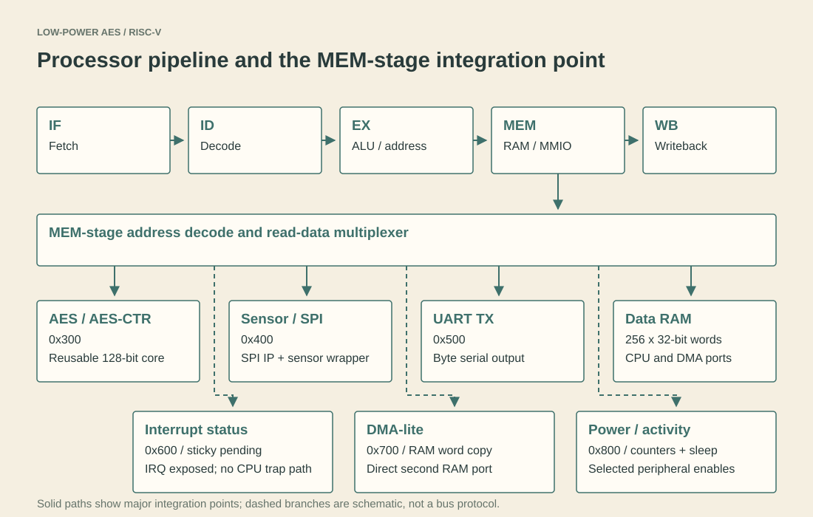

# IEEE ISAIA 2026 - RISC-V security processor

[Project home](../../README.md) · [GCON paper](gcon-2026.md) · [Integration explanation](../02-riscv-integration.md)

**A Lightweight RISC-V Security Processor with AES-CTR Acceleration and Custom ISA Support for IoT Edge Nodes**

Varada Inamdar and Dr. Ashwini Kulkarni, COEP Technological University, Pune, India.

Paper 214, 2026 IEEE International Conference on Intelligent Systems and Interdisciplinary Applications (ISAIA), October 9-10, 2026, Montclair, USA. [Official conference](https://www.ieeeisaia.com/)

A public paper DOI/Xplore record has not been confirmed for this repository update. This page is an implementation guide, not a substitute publication record or a claim of completed indexing.

## The system-level contribution

The processor integrates the reusable AES core from the [GCON work](gcon-2026.md) with a five-stage RV32I-style pipeline. AES-CTR is controlled through ordinary loads/stores and a small custom-0 instruction path. Sensor/SPI, UART, DMA-lite, interrupt status and activity counters provide the surrounding edge-node demonstration.

## A practical reading order

Start with [32-bit to 128-bit MMIO packing](../02-riscv-integration.md#a-32-bit-cpu-can-control-128-bit-aes). Then follow the memory-stage decode, AES mode control and custom-instruction commands. Read [interrupts and activity](../03-interrupts-and-power.md) after the encryption path is clear.

| Item | Link |
| --- | --- |
| Complete processor pipeline | [riscv_aes_advancements.sv](../../rtl/top/riscv_aes_advancements.sv) |
| RAM/MMIO/custom-command integration | [mem_stage.sv](../../rtl/cpu/mem_stage.sv) |
| AES-CTR peripheral | [aes_mmio.sv](../../rtl/aes/aes_mmio.sv) |
| Custom opcode decoding | [control_unit.sv](../../rtl/cpu/control_unit.sv) |
| Peripheral addresses and bits | [Register reference](../register-map.md) |
| CPU-driven application | [Scenario description](../../tb/scenarios/secure_health_monitoring_scenario_testcase.md), [testbench](../../tb/directed/riscv_core_tb.sv) |
| Directed and UVM scope | [Verification chapter](../04-verification.md) |
| Archived FPGA evidence | [Quartus reports](../../results/quartus_soc/) |

## Paper snapshot versus later project work

The manuscript checked during this reorganization reports 83 passing checks, 12,825 estimated ALMs and 10,461 registers. The later preserved FPGA report shows 13,257 ALMs and 11,154 registers, while the current full directed regression has 107 checks. Keep the version attached to the metric; this `final` branch is an evolving integrated project, not a frozen submission artifact.

The later UVM work checks the AES/UART subsystem with an independent C model. It does not demonstrate a CPU CSR/trap interrupt path or whole-SoC UVM coverage. See [results](../05-results.md) and [limitations](../limitations.md).

No privately stored manuscript, copyright receipt, registration form or conference access credentials were uploaded as part of this cleanup. Once a public DOI is available, it can be added here separately from the implementation link.

[ISAIA implementation and explanation](https://github.com/Varadain/RISCV_lowPowerAES128/blob/final/docs/papers/isaia-2026.md)
