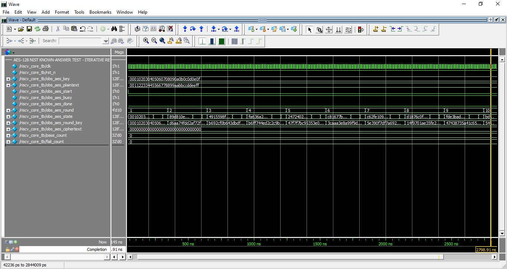
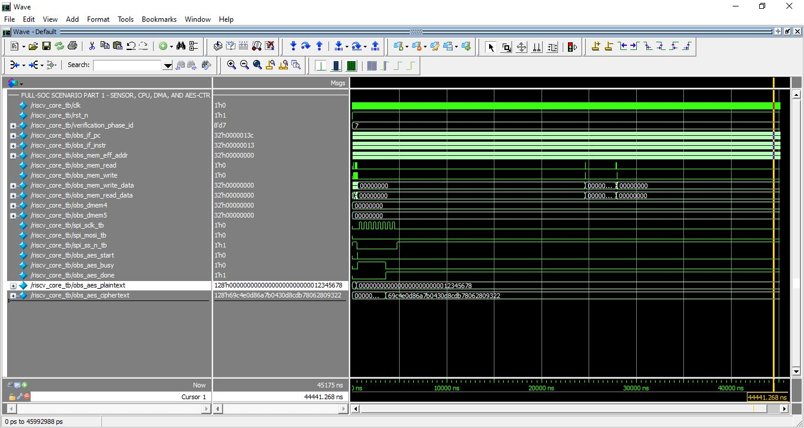
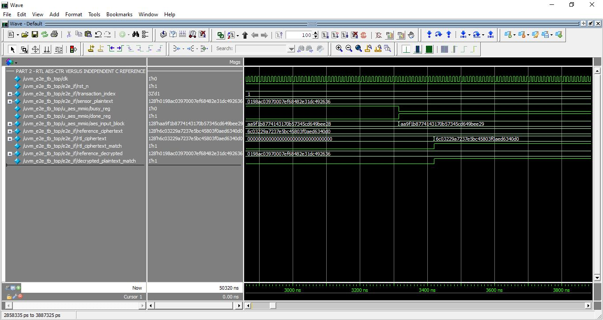

# Evidence gallery

[Project home](../README.md) · [Verification explanation](../docs/04-verification.md) · [Results interpretation](../docs/05-results.md)

These are original saved transcripts and screenshots, not newly fabricated measurements. Duplicate screenshot copies have been removed; each unique image is kept under its test group with a shorter name. Fresh post-cleanup validation is recorded in [validation.md](validation.md).

## Directed tests

| Saved run | Summary | Evidence |
| --- | --- | --- |
| AES through MMIO | 6 pass / 0 fail | [Log](directed/01_aes_known_answer_capture.log), [waveform](directed/aes-known-answer.jpg) |
| CPU examples | 47 pass / 0 fail | [Log](directed/02_directed_cpu.log), [R/I](directed/cpu-r-i.jpg), [load/store](directed/cpu-load-store.jpg), [control flow](directed/cpu-control-flow.jpg) |
| Peripherals/custom commands | 25 pass / 0 fail | [Log](directed/03_directed_peripheral.log), [AES/SPI](directed/peripheral-aes-sensor-spi.jpg), [IRQ/power](directed/peripheral-interrupts-power.jpg), [custom ISA](directed/peripheral-custom-isa.jpg) |
| Deterministic random smoke | 5 pass / 0 fail | [Log](random_smoke/04_random_smoke.log), [waveform](random_smoke/smoke.jpg) |

For AES, follow programmed key/plaintext, start, busy, the round state and completion. The log checks each 32-bit ciphertext word against the expected vector.

## CPU-driven full-system scenario

[Scenario description](../tb/scenarios/secure_health_monitoring_scenario_testcase.md) · [15-check log](full_soc_scenario/07_full_soc_scenario.log)

The first view follows sensor/RAM/DMA/AES activity. [The second view](full_soc_scenario/events-and-power.jpg) follows UART, pending events, activity counters and sleep. The scenario sends the low ciphertext byte as its UART check, rather than demonstrating a complete authenticated telemetry packet.

## Randomized AES/UART UVM

The saved 25-transaction seed-101 run reports 25 UART matches, zero mismatches, and 96/114 portable transaction bins. [Transcript](uvm_e2e/05_uvm_e2e_25_seed101.log)

Follow its views in order: [inputs](uvm_e2e/inputs.jpg), [AES/reference match](uvm_e2e/aes-reference-match.jpg), [UART reconstruction](uvm_e2e/uart-monitor.jpg), [scoreboard](uvm_e2e/scoreboard.jpg).

The 100-transaction seed-611 run reports 114/114 bins and 100 UART matches. [Transcript](functional_coverage/06_functional_coverage_100_seed611.log) · [coverage growth](functional_coverage/coverage-growth.jpg) · [final summary](functional_coverage/coverage-summary.jpg)

This is the AES/UART subsystem environment, not CPU/whole-SoC UVM verification. The screenshots contain synthetic test data and keys for debugging.

## Original synthesis and implementation reports

[Standalone AES Genus reports](../asic/cadence_genus/reports/) · [Archived mapped output](../asic/cadence_genus/outputs/) · [Integrated Quartus reports](quartus_soc/)

The [results chapter](../docs/05-results.md) explains units, technologies, timing assumptions and manuscript/report differences. Original report text and binary screenshots have not been recoloured or rewritten.
